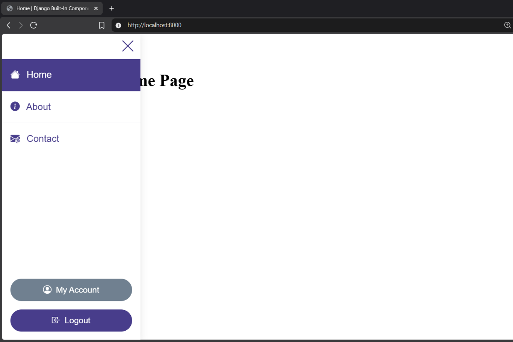
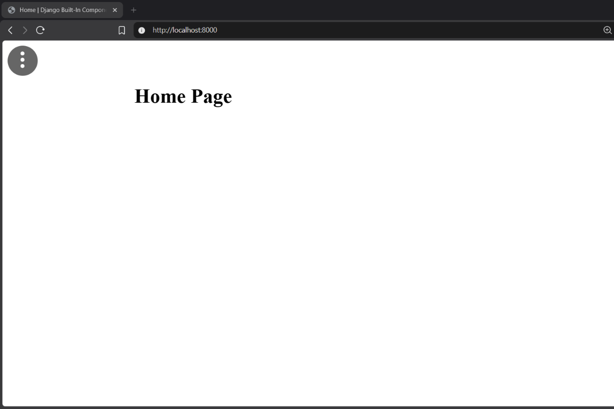

# Django Built-In Components Demo

> [!WARNING]
> This project is just a demo and is **NOT** intended for production use as is.

A demo Django project to demonstrate the use of Django's `inclusion_tag` and modern Web features to create components.

## About





In this demo, the `inclusion_tag` ([see docs](https://docs.djangoproject.com/en/dev/howto/custom-template-tags/#inclusion-tags)) provides data for a sidebar component, and a single template encapsulates the HTML, CSS, and JS, allowing the component to be easily re-used across templates.

Here are some code excerpts demonstrating how the component is defined and used:

```python
# Excerpt from: demo/templatetags/demo.py

@register.inclusion_tag('demo/components/sidebar.html', takes_context=True)
def sidebar(context):
    request = context['request']
    links = [
        [_('Home'), reverse('demo:home'), 'bi-house-fill'],
        [_('About'), reverse('demo:about'), 'bi-info-circle-fill'],
        [_('Contact'), reverse('demo:contact'), 'bi-envelope-at-fill'],
    ]

    links[0].append(request.path_info == links[0][1])

    for link in links[1:]:
        link.append(request.path_info.startswith(link[1]))

    return {'request': request, 'links': links}

```

```django
{# Excerpt from: demo/templates/demo/components/sidebar.html #}

<aside class="sidebar" tabindex="-1">
    {# lines omitted for brevity #}

    <div>
        <style>
            @scope {
                ul {
                    margin: 0;
                    padding: 0;
                    font-size: 18px;
                }

                li a {
                    display: block;
                    transition: all .2s;
                    cursor: pointer;
                    border-bottom: 1px solid rgb(from var(--primary-color) r g b / 20%);
                    padding: 20px 16px;
                }

                li:last-of-type a {
                    border-bottom-color: transparent;
                }

                li a:is(.active, :hover, :focus) {
                    border-bottom-color: var(--primary-color);
                    background-color: var(--primary-color);
                    color: white;
                }

                li i {
                    margin-right: 8px;
                }
            }
        </style>

        <ul>
            
            <li>
                <a href="{{ url }}" class="active">
                    <i class="bi {{ icon_class }}"></i> {{ name }}
                </a>
            </li>
            
        </ul>
    </div>

    {# lines omitted for brevity #}
</aside>

<script>
    const sidebar = document.querySelector('.sidebar')
    const sidebarOpenBtn = document.querySelector('.sidebar-open-btn')
    const sidebarCloseBtn = sidebar.querySelector('.sidebar-close-btn')

    const openSidebar = () => {
        sidebar.classList.add('open')
        sidebarCloseBtn.focus()
    }

    const closeSidebar = () => {
        sidebar.classList.remove('open')
    }

    const isSidebarOpen = () => sidebar.classList.contains('open')

    sidebarOpenBtn.addEventListener('click', openSidebar)
    sidebarCloseBtn.addEventListener('click', closeSidebar)

    {# lines omitted for brevity #}
</script>

```

```django
{# Excerpt from: demo/templates/demo/home.html #}


 {# <-- component in use= #}
<h1>Home Page</h1>


```

I would like to note that, while this project didn't require it, the `inclusion_tag` supports parameters, allowing customization.

Also, while this project uses pure CSS/JS, other frameworks and libraries can easily be used.

This project uses [Bootstrap Icons](https://icons.getbootstrap.com/), via the [jsDelivr CDN](https://www.jsdelivr.com/).

## Installation

### 1. Clone repo: 
```
git clone https://github.com/osmium2259/django_builtin_components_demo.git && cd django_builtin_components_demo
```

### 2. Setup Python environment:

```
python -m venv venv
```

#### Unix:

```
source venv/bin/activate
```

#### Windows:

```
venv\Scripts\activate.bat
```

### 3. Install packages (actually just one 😉):

```
pip install -r requirements.txt
```

### 4. Start dev server:

```
python manage.py runserver
```

### 5. Go to http://localhost:8000/ and check it out!

## License

MIT
